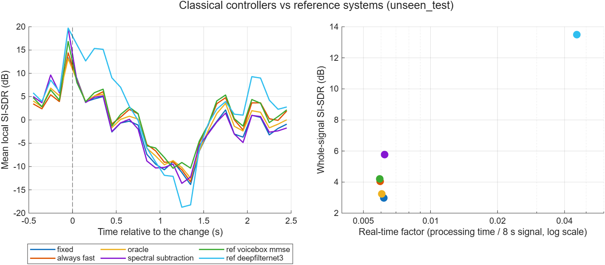
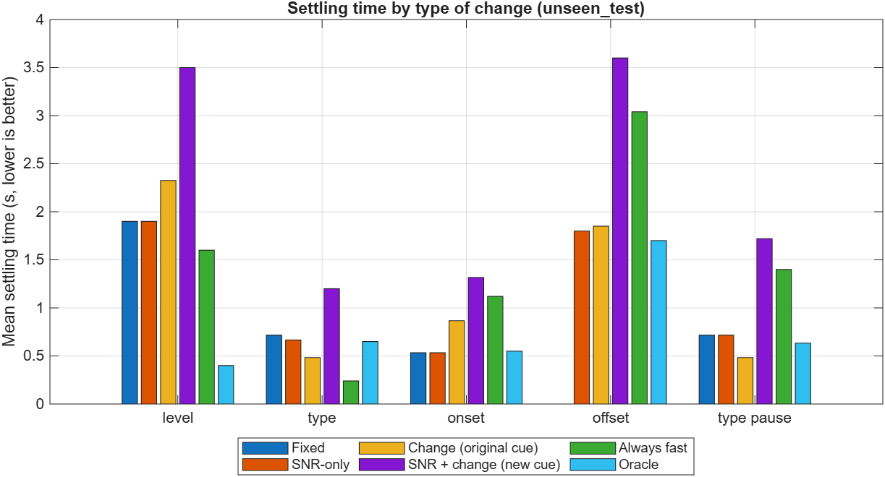
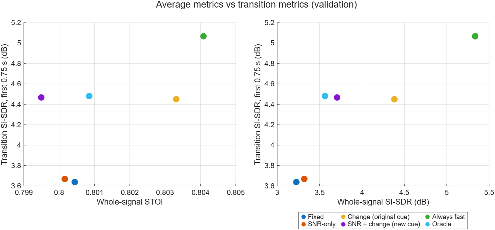
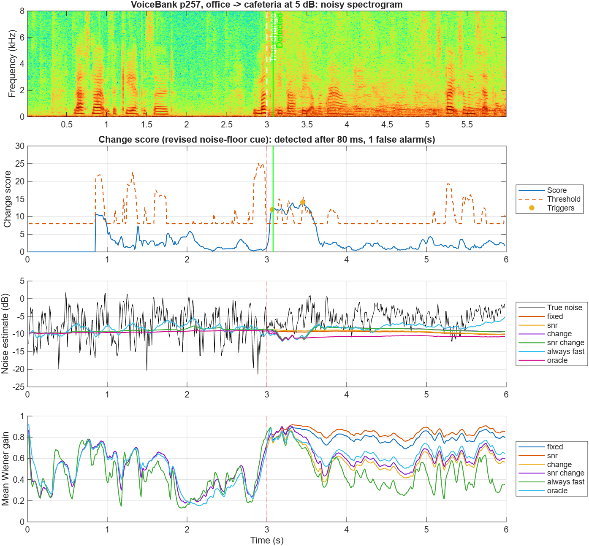

# How Quickly Should a Speech Enhancer Adapt?

### Change-aware Wiener filtering when the background noise suddenly changes

ELEC5305 project, Semester 2 2026
Liya Xu (SID 530519058) | GitHub: [Liyaxuxu](https://github.com/Liyaxuxu)

## Final submission

| Item | Link |
|---|---|
| Final report (PDF) | [report/main.pdf](https://github.com/Liyaxuxu/elec5305-project-530519058/blob/main/report/main.pdf) |
| Video demo | [YouTube](https://youtu.be/natY-4UzcTU) (backup: [Google Drive](https://drive.google.com/file/d/1G7SuL2PIYqyZcJeBJBOGOTtxOiQHFxEb/view)) |
| Project website | [liyaxuxu.github.io/elec5305-project-530519058](https://liyaxuxu.github.io/elec5305-project-530519058/) |
| Week 10 checkpoint | [docs/feedback-two.md](docs/feedback-two.md) |
| Proposals | [Original](Proposal/Proposal.pdf) and [updated version (proposal_2)](Proposal/proposal_2.pdf) |

## Short answer

On my test scenes, the results favour faster adaptation. The explicit change detectors did not outperform simply using the fast setting all the time:

- The more of the time a controller spends in its fast-update state, the higher its SI-SDR (correlation r = 0.97 on validation, 0.95 on the unseen cafeteria test, over the 8 Wiener controllers).
- An "always fast" controller beat both change-aware controllers on both test sets (+0.95 dB and +0.47 dB SI-SDR vs. the original change-aware controller, both significant).
- The classical systems are weakest exactly at the changes: when noise **starts**, none of them (including VOICEBOX) removes it in the first 0.75 s; when noise **stops**, all of them keep suppressing and damage the now clean speech.
- None of the classical systems improved STOI. Only the pretrained DeepFilterNet3 improved both SI-SDR and STOI.

Details, numbers and limitations are below.

## Quick start

### Requirements

- MATLAB R2026a or a compatible release
- Signal Processing Toolbox (`stft`, `istft`, `resample`)
- Audio Toolbox (`stoi`, used by the real-data experiments)
- Optional: Python 3.10 for the DeepFilterNet3 reference (see Option C)

### Option A: run without downloading any data (about 1 minute)

From the repository root:

```matlab
addpath('src');
run('src/run_transition_demo.m');   % synthetic noise change, all four controllers
run('tests/run_tests.m');           % automated checks
```

The demo prints a metrics table and saves a figure and two CSV files to `tmp/transition_demo/`, and five `.wav` listening examples to `tmp/transition_demo/audio/`. Copies of the demo audio are already committed in [`results/audio/`](results/audio/) if you just want to listen. The tests should finish with `All speech-enhancement tests passed.`

### Option B: reproduce the real-data results

1. Download the VoiceBank clean test set and the DEMAND `OOFFICE`, `STRAFFIC` and `PCAFETER` recordings (16 kHz). Links and MD5 checksums are in [`data/README.md`](data/README.md).
2. Put them in `data/raw/clean_testset_wav/` and `data/raw/<NOISE>/ch01.wav`.
3. Optional reference: download [VOICEBOX](http://www.ee.ic.ac.uk/hp/staff/dmb/voicebox/voicebox.html) and copy `specsub.m`, `estnoisem.m`, `estnoiseg.m`, `enframe.m`, `rfft.m`, `irfft.m` and `axisenlarge.m` into `tools/external/voicebox/`. VOICEBOX is GPL licensed, so it is **not** included in this repository (the folder is in `.gitignore`).
4. Run from the repository root:

```matlab
addpath('src');
run('tests/run_tests.m');
run('tools/check_against_voicebox.m');   % only if VOICEBOX was installed in step 3
run_controller_ablation("develop");      % choose the controller setting on p232 only
run_controller_ablation("validate");     % frozen setting, validation split
run_controller_ablation("test");         % frozen setting, unseen office -> cafeteria split
summarise_controller_ablation;           % final tables, paired bootstrap, hypothesis tests
run('src/run_auditor_example.m');        % Figure 1 (Dynamic Speech Enhancement Auditor)
```

The earlier experiments can be rerun with `run('src/run_full_transition_study.m')` (pilot) and `run_detector_revision('develop')`, `run_detector_revision('validate')`, `summarise_detector_revision` (detector audit). All CSV files and figures shown below are saved in `results/`, so you can look at them without running anything. Raw dataset audio is not included in this repository.

### Option C (optional): DeepFilterNet3

DeepFilterNet3 is used only as a pretrained modern reference. Nothing is trained.

```bash
conda create -n dfn python=3.10 -y
conda activate dfn
pip install -r tools/requirements-dfn.txt
python tools/run_deepfilternet.py data/dfn_io/validation
python tools/run_deepfilternet.py data/dfn_io/unseen_test
python tools/run_deepfilternet.py data/dfn_io/auditor
```

The noisy inputs in `data/dfn_io/` are written by `run_controller_ablation` and `run_auditor_example`. After the Python step, run `run_controller_ablation("validate")`, `run_controller_ablation("test")`, `run_auditor_example` and `summarise_controller_ablation` again so the DeepFilterNet3 outputs are scored with exactly the same metrics.

**Runtime record.** `data/dfn_io/` is not in the repository, so the DeepFilterNet3 timings used in the report are also saved as [`results/controller_ablation/validation_dfn_runtime.csv`](results/controller_ablation/validation_dfn_runtime.csv) and [`unseen_test_dfn_runtime.csv`](results/controller_ablation/unseen_test_dfn_runtime.csv); `summarise_controller_ablation` uses these copies if `data/dfn_io/` is missing. What was timed:

- DeepFilterNet3: per file, 16 → 48 kHz resampling + model inference + resampling back, measured in `tools/run_deepfilternet.py`. Model loading and file reading/writing are not included.
- Wiener controllers, spectral subtraction and VOICEBOX: MATLAB `tic`/`toc` around the enhancement call in `run_controller_ablation.m`. For the change-aware controllers the detector features are computed beforehand and are not included.
- Everything ran on my Windows laptop on the CPU only (no GPU), with MATLAB R2026a, Python 3.10, torch 2.0.1, torchaudio 2.0.2 and deepfilternet 0.5.6. Runtimes are only meant for a rough comparison on one machine.

## What this project is about

Most speech enhancement examples assume the background noise stays the same. In real life it doesn't: a fan turns on, you walk from an office into a cafeteria, traffic gets louder. A simple STFT Wiener filter has to re-estimate the noise when this happens, and for a short time after the change it can either leave a lot of noise or damage the speech.

My main research question is:

> When the acoustic environment changes abruptly, how quickly should a causal STFT speech enhancer adapt, and can a lightweight change-aware controller reduce adaptation delay and speech distortion compared with fixed and SNR-only baselines?

Two supporting analyses help to answer it:

1. Do normal whole-utterance metrics hide short but important failures right after the change?
2. How does this interpretable DSP system compare with a pretrained real-time neural enhancer?

To keep the main Wiener comparison fair, all Wiener systems use the same STFT and Wiener-gain calculation. The main difference is the *controller*, i.e. how fast the noise estimate is updated and how much the gain is smoothed over time.

## Method

```text
clean speech + noise A + noise B (known change time)
                    |
                    v
             causal STFT (32 ms frames, 8 ms hop)
                    |
     +--------------+---------------+
     |              |               |
   fixed        SNR-only      change-aware / oracle / always-fast
 controller    controller         controller
     |              |               |
     +--------------+---------------+
                    |
              Wiener gain -> ISTFT
                    |
                    v
   whole-signal metrics + metrics just after the change
```

### Systems

| System | What it does |
|---|---|
| Fixed Wiener | Noise update rate and gain smoothing never change. |
| SNR-only | Updates faster when the estimated frame SNR is low. |
| Change (original cue) | The original combined change detector triggers a 0.35 s fast state. |
| Change (revised cue) | Same, but with my revised noise-floor detector (fewer false alarms). |
| SNR + change | SNR rule plus the change trigger; the faster rate wins. |
| Always fast | The fast state is used all the time. Tests whether detection is needed at all. |
| Oracle | Fast state triggered at the true change time. Only for diagnosis. |
| Spectral subtraction | Fixed course baseline (noise from the first 250 ms). |
| VOICEBOX MMSE Wiener | Published adaptive noise tracker (Gerkmann & Hendriks 2012), used as a reference. |
| DeepFilterNet3 | Pretrained real-time neural enhancer, used as a modern reference. |

The controller setting (fast gain smoothing, hold time, release ramp and gain floor) was chosen **on development data only**, using the oracle trigger so detector errors could not affect the choice. The frozen setting is in [`frozen_controller.json`](results/controller_ablation/frozen_controller.json): fast noise smoothing coefficient α = 0.90, fast gain smoothing coefficient 0.75, hold 0.35 s, no release ramp, gain floor 0.05. Longer holds, a release ramp and a higher gain floor were tested but did not win on development data ([search table](results/controller_ablation/development_controller_search.csv)).

### Test scenes

Each case is 8 s of VoiceBank speech mixed with DEMAND noise. There is a 0.5 s noise-only start. The change point is first selected from an active-speech region between 2.5 and 4.5 s. The type_pause condition uses the same change point and noise but fades the reference speech to silence around it.

- Changes: noise **level** jump (10 dB), noise **type** change, noise **onset**, noise **offset**, and a type change during a short **pause** in the speech.
- No-change controls: stationary noise A, stationary noise B, and clean speech only.
- In the controller ablation, "quiet" before an onset and after an offset is a -30 dB noise floor instead of digital silence. With digital silence every noise tracker I tried, including VOICEBOX, stays at zero, so the onset could not be measured at all.
- The real SNR before and after each change is saved in the manifests.

| Split | Speaker | Noise A → B | Used for |
|---|---|---|---|
| Development | p232 | office → traffic | choosing the detector and the controller setting |
| Validation | p257 (unused utterances) | office → traffic | first frozen test (this split was also looked at in October) |
| Unseen test | p257 (utterances never used before) | office → **cafeteria** | final test: unseen utterances, unseen noise excerpts and an unseen transition pair |

**The unseen test is not an unseen-speaker test.** The VoiceBank clean test set only contains p232 and p257, and both had already been used.

### Metrics and statistics

- Whole signal: SI-SDR, segmental SNR, SNR improvement (paired against the noisy input), STOI, runtime.
- Around the change: SI-SDR in the first 0.75 s, steady-state SI-SDR 1.5–2.5 s later, settling time, speech distortion and residual noise (the saved Wiener gain is applied to the clean speech and the noise separately).
- Detection: hit rate within 1.5 s, latency, false alarms per minute (including no-change controls).
- The clean-speech control is left out of all averages (the Wiener systems reproduce it exactly, so its SI-SDR is undefined). The pause condition is left out of transition averages because the reference is silent right at the change.
- Uncertainty: paired cluster bootstrap over the six speech sequences (5000 resamples). "Significant" below means the 95% interval does not include zero. Six sequences is a small sample.

The controller-ablation tables below come from [`summarise_controller_ablation.m`](src/summarise_controller_ablation.m). The detector audit and the reference check under "Earlier experiments" come from [`run_detector_revision.m`](src/run_detector_revision.m) / [`summarise_detector_revision.m`](src/summarise_detector_revision.m) and [`tools/check_against_voicebox.m`](tools/check_against_voicebox.m).

## Results

### Main table

Means over the 42 cases with noise (clean control excluded), selected controller setting.

| System | Val. SI-SDR (dB) | Val. STOI | Unseen SI-SDR (dB) | Unseen STOI |
|---|---:|---:|---:|---:|
| Noisy input | 1.17 | 0.806 | 1.10 | 0.767 |
| Fixed Wiener | 3.22 | 0.800 | 2.97 | 0.756 |
| SNR-only | 3.32 | 0.800 | 2.87 | 0.757 |
| Change (revised cue) | 3.66 | 0.801 | 3.31 | 0.755 |
| Oracle | 3.56 | 0.801 | 3.24 | 0.757 |
| Change (original cue) | 4.38 | 0.803 | 3.57 | 0.755 |
| Always fast | 5.33 | 0.804 | 4.04 | 0.754 |
| VOICEBOX MMSE | 6.02 | 0.804 | 4.20 | 0.756 |
| Spectral subtraction | 7.20 | 0.806 | 5.76 | 0.760 |
| DeepFilterNet3 | **16.05** | **0.837** | **13.50** | **0.804** |

Full tables (including segmental SNR, SNR improvement, settling time, speech error and noise suppression): [validation](results/controller_ablation/validation_final_table.csv), [unseen test](results/controller_ablation/unseen_test_final_table.csv).

### Paired comparisons

| Comparison (A − B) | Validation | Unseen test |
|---|---|---|
| Always fast − fixed, SI-SDR | **+2.11** [1.74, 2.48] | **+1.07** [0.78, 1.33] |
| Change (original) − fixed, SI-SDR | **+1.16** [0.95, 1.35] | **+0.60** [0.26, 0.95] |
| SNR-only − fixed, SI-SDR | +0.10 [−0.09, 0.27] | −0.10 [−0.22, 0.01] |
| Always fast − change (original), SI-SDR | **+0.95** [0.57, 1.35] | **+0.47** [0.26, 0.66] |
| Change (original) − oracle, SI-SDR | **+0.82** [0.59, 1.02] | **+0.32** [0.03, 0.63] |
| Oracle − fixed, transition SI-SDR | **+0.84** [0.54, 1.24] | **+0.58** [0.02, 1.01] |
| Oracle − always fast, transition SI-SDR | **−0.59** [−0.92, −0.25] | −0.49 [−1.02, 0.11] |
| Fixed − noisy, STOI | **−0.005** | **−0.011** |
| DeepFilterNet3 − noisy, STOI | **+0.032** | **+0.037** |

Bold = 95% interval excludes zero. Files: [validation](results/controller_ablation/validation_paired_bootstrap.csv), [unseen test](results/controller_ablation/unseen_test_paired_bootstrap.csv).

The original change-aware controller beats the oracle on the whole signal even though the oracle knows the true change time. It spends 35–38% of the time in the fast state, compared with 3% for the oracle, and always-fast (100%) is better again. This pattern suggests that much of the gain comes from adapting more often rather than from accurate change timing alone.



### What happens at each type of change

Mean SI-SDR in the first 0.75 s after the change (dB, unseen test):

| Change | Noisy | Fixed | SNR-only | Change (orig.) | Always fast | Oracle | VOICEBOX | DeepFilterNet3 |
|---|---:|---:|---:|---:|---:|---:|---:|---:|
| Level | 0.32 | 2.55 | 2.31 | 2.21 | 3.04 | 3.19 | 1.95 | 18.97 |
| Type | 0.16 | 2.58 | 2.47 | 2.70 | 2.73 | 2.75 | 2.46 | 9.97 |
| Onset | 0.16 | 0.15 | 0.23 | 0.44 | 0.67 | 0.22 | 0.35 | 9.44 |
| Offset | 30.18 | 10.90 | 12.32 | 14.69 | 14.00 | 12.31 | 18.06 | 17.43 |

- **Onset:** no classical system (not even VOICEBOX) removes a newly started noise within 0.75 s. My noise update treats the sudden energy rise as speech and hardly updates. DeepFilterNet3 handles it immediately.
- **Offset:** after the noise stops, the input is almost clean (about 30 dB), but every classical system keeps suppressing and drops to 11–18 dB. Fast adaptation helps here: the original change-aware controller is about 2.4 dB better than SNR-only, significant on both test sets.

Validation shows the same pattern ([validation](results/controller_ablation/validation_by_condition.csv), [unseen](results/controller_ablation/unseen_test_by_condition.csv)).



Note: settling time only says how quickly the error becomes stable, not how good it is. Some cases never settle within the recording; the means only cover the cases that did (14 to 20 of the 24 level/type/onset/offset cases, depending on the system and split). The noisy input "settles" immediately because it never adapts.

### Condition-wise hypothesis test

The working hypothesis was that SNR-only adaptation should handle level changes, while a spectral/modulation change cue should help more when the noise *type* changes at a similar level. I tested this directly as a difference-in-differences: (change − SNR-only) for type changes minus (change − SNR-only) for level changes.

- Validation: positive but not significant (original cue +0.26 dB [−0.21, 0.70]).
- Unseen cafeteria test: the revised cue was **significantly worse** for type changes than for level changes (−0.49 dB [−1.05, −0.11]).

So the hypothesis was **not supported**. Where the change cue helps most is the offset, i.e. letting go after the noise stops. Files: [validation](results/controller_ablation/validation_hypothesis_by_condition.csv), [unseen](results/controller_ablation/unseen_test_hypothesis_by_condition.csv).

### Do whole-signal averages hide transition failures? (question 2)

Partly. Ranking the systems by whole-signal SI-SDR and by transition SI-SDR gives a rank correlation of 0.91 (validation) and 0.81 (unseen), so the overall ranking mostly agrees. But the averages hide the condition-specific failures above: the onset is basically not enhanced at all, and the offset damages clean speech, and neither shows up clearly in a whole-utterance number. The oracle is also a good example: it ranks low on the whole signal but is among the best right after level and type changes.



### Figure 1: one change seen by the Auditor



The [Dynamic Speech Enhancement Auditor](src/dynamic_enhancement_auditor.m) takes clean speech, two noises, a change time and the SNRs, and produces the mixture, every system's output, the metrics, these figures and audio. The example uses unused p257 speech and an office → cafeteria change at 5 dB. This 6 s example has no noise-only prefix and initialises the noise estimate from the first 250 ms, so it does not follow the causal start-up used in the main experiments.

**This is an illustrative example, not a typical one.** The script scans noise excerpts in a fixed order and takes the first one where the revised detector finds the change (rule written in [`run_auditor_example.m`](src/run_auditor_example.m); the scan is saved in [`example_choice.csv`](results/auditor_example/example_choice.csv)). Here the first excerpt already qualified: the change was detected after 80 ms with one false alarm. Typical detection rates are in the detector audit below. Spectrograms of all outputs: [`auditor_spectrograms.png`](results/auditor_example/auditor_spectrograms.png).

### Earlier experiments

- **Detector audit (October):** the revised noise-floor detector found 23/30 changes (original: 20/30) and reduced false alarms on no-change controls from 62.4 to 41.9 per minute, but it gave *more* false alarms on clean speech (98.6 vs 65.7 per minute). It used digital silence for onset/offset. [Details](results/detector_revision/README.md).
- **Reference check:** on stationary noise my fixed Wiener filter is in the same range as the references (office: 6.39 dB vs 5.99 dB with the true noise PSD and 4.56 dB for VOICEBOX MMSE; traffic: 4.24 vs 4.90 and 5.40 dB). [Table](results/reference_check/reference_check_summary.csv).
- **Pilot study:** first version with three speech sequences per speaker and all changes at 3.0 s. Its startup was not fully causal, so its numbers are not comparable. [Results](results/README.md).

## What I learned

- Adapting fast is more important than knowing exactly when the scene changed, at least for these office/traffic/cafeteria scenes. A better detector (revised cue) did not give a better enhancer.
- The bigger problem is the noise tracker and gain rule themselves. Even plain spectral subtraction beat all my Wiener controllers on SI-SDR, and VOICEBOX's MMSE tracker was better too. My speech-weighted noise update is too conservative: it cannot follow a noise onset and it holds on to old noise after an offset.
- SI-SDR improvements did not turn into STOI improvements for any classical system, which matches Loizou and Kim (2011).
- DeepFilterNet3 produced the best overall SI-SDR, segmental SNR and STOI (about +9–11 dB SI-SDR over always-fast and +0.03–0.04 STOI over noisy). It also handled the onset cases much better, although it did not always have the shortest settling time. Its runtime was about eight times that of my MATLAB systems (real-time factor about 0.05 vs 0.006 on my computer's CPU). The classical system remains useful because its internal estimates and gains can be inspected directly.

## Limitations

1. **No unseen speaker.** All final tests use p257 (see above).
2. Small sample: six speech sequences per split and three DEMAND environments.
3. The validation split had already been looked at in October; the cafeteria split is the only fully fresh test.
4. The October detector audit used digital silence for onset/offset; the controller ablation uses a -30 dB floor.
5. The MATLAB Central Boll/Scalart implementations were not used. VOICEBOX, the true-PSD Wiener filter and spectral subtraction were used as references instead.
6. Figure 1 is a selected example (rule above), not a representative case.
7. An experimental "noise-floor guard" fixed the frozen onset estimate but overestimated noise during speech, so it was left out of the final controller.

## Future work

1. Replace the speech-weighted noise update by a proper tracker (e.g. MMSE / minimum statistics) and then test whether a change trigger still helps on top of it.
2. Add a faster release after offsets.
3. Test on more speakers (VoiceBank training set) and more noise environments.

## Project status

| Part | Status |
|---|---|
| Research question and literature review ([`literature_review.md`](literature_review.md)) | Done |
| Data (VoiceBank + DEMAND office, traffic, cafeteria) | Done |
| Common Wiener pipeline with six controller modes | Done |
| Pilot study and detector audit | Done |
| Controller ablation (hold, release, gain floor, always-fast, SNR + change) | Done |
| Unseen office → cafeteria test | Done (not an unseen speaker) |
| Spectral subtraction, VOICEBOX and DeepFilterNet3 references | Done |
| Paired statistics, hypothesis test, ranking analysis | Done |
| Dynamic Speech Enhancement Auditor (Figure 1) | Done |
| Final report and video | Done ([report](report/main.pdf), [video](https://youtu.be/natY-4UzcTU)) |

## Repository structure

```text
.
|-- src/
|   |-- transition_wiener.m             Wiener filter with all controller modes
|   |-- scene_change_detector.m         original change cues
|   |-- robust_change_features.m        noise-floor cue (revised detector)
|   |-- trigger_change_features.m       revised detector triggers
|   |-- score_change_events.m           matches triggers to changes, counts false alarms
|   |-- generate_dynamic_scene.m        noise change at a known time
|   |-- build_detector_cases.m          development / validation / unseen-test cases
|   |-- transition_metrics.m            all enhancement metrics
|   |-- spectral_subtraction.m          course baseline
|   |-- run_controller_ablation.m       main experiment
|   |-- summarise_controller_ablation.m final tables and statistics
|   |-- plot_controller_ablation.m      figures
|   |-- plot_onset_noise_estimate.m     noise estimate around an onset
|   |-- dynamic_enhancement_auditor.m   Auditor
|   |-- run_auditor_example.m           Figure 1
|   |-- run_detector_revision.m         detector audit (October)
|   |-- run_full_transition_study.m     pilot study
|   `-- run_transition_demo.m           demo without data
|-- tests/                              automated MATLAB checks
|-- tools/
|   |-- check_against_voicebox.m        reference check
|   |-- run_deepfilternet.py            optional DeepFilterNet3 reference
|   `-- requirements-dfn.txt
|-- report/                             final report (LaTeX source, figures, PDF)
|-- results/                            figures, CSV results and audio examples
|-- data/                               dataset instructions and manifest (no audio)
|-- docs/                               project website and Week 10 checkpoint
|-- Proposal/                           original and updated proposal
|-- literature_review.md
`-- references.bib
```

Older experiments that I replaced are kept on the [`bench` branch](https://github.com/Liyaxuxu/elec5305-project-530519058/tree/bench).

## Main references

1. S. F. Boll, "Suppression of Acoustic Noise in Speech Using Spectral Subtraction," *IEEE Trans. ASSP*, 1979. [doi:10.1109/TASSP.1979.1163209](https://doi.org/10.1109/TASSP.1979.1163209)
2. P. Scalart and J. V. Filho, "Speech Enhancement Based on a Priori Signal to Noise Estimation," *ICASSP*, 1996. [doi:10.1109/ICASSP.1996.543199](https://doi.org/10.1109/ICASSP.1996.543199)
3. R. Martin, "Noise Power Spectral Density Estimation Based on Optimal Smoothing and Minimum Statistics," *IEEE Trans. Speech and Audio Processing*, 2001. [doi:10.1109/89.928915](https://doi.org/10.1109/89.928915)
4. T. Gerkmann and R. C. Hendriks, "Unbiased MMSE-Based Noise Power Estimation With Low Complexity and Low Tracking Delay," *IEEE Trans. ASLP*, 2012. [doi:10.1109/TASL.2011.2180896](https://doi.org/10.1109/TASL.2011.2180896)
5. P. C. Loizou and G. Kim, "Reasons Why Current Speech-Enhancement Algorithms Do Not Improve Speech Intelligibility and Suggested Solutions," *IEEE Trans. ASLP*, 2011. [doi:10.1109/TASL.2010.2045180](https://doi.org/10.1109/TASL.2010.2045180)
6. H. Schröter et al., "DeepFilterNet: Perceptually Motivated Real-Time Speech Enhancement," *Interspeech*, 2023.
7. C. H. Taal et al., "An Algorithm for Intelligibility Prediction of Time-Frequency Weighted Noisy Speech," *IEEE Trans. ASLP*, 2011. [doi:10.1109/TASL.2011.2114881](https://doi.org/10.1109/TASL.2011.2114881)
8. C. Valentini-Botinhao, "Noisy Speech Database for Training Speech Enhancement Algorithms and TTS Models," University of Edinburgh DataShare, 2017. [doi:10.7488/ds/2117](https://doi.org/10.7488/ds/2117)
9. J. Thiemann, N. Ito, and E. Vincent, "The Diverse Environments Multi-channel Acoustic Noise Database (DEMAND)," *Proc. Meetings on Acoustics*, 2013. [doi:10.1121/1.4799597](https://doi.org/10.1121/1.4799597)
10. M. Brookes, "VOICEBOX: Speech Processing Toolbox for MATLAB," Imperial College London.

The full list is in [`literature_review.md`](literature_review.md) and [`references.bib`](references.bib).

## Licence

The code in this repository is released under the [MIT License](LICENSE). VOICEBOX (GPL) and the DeepFilterNet3 model are used as external references and are not redistributed here. Datasets and published methods belong to their authors and are cited above.

Copyright (c) 2026 Liya Xu
