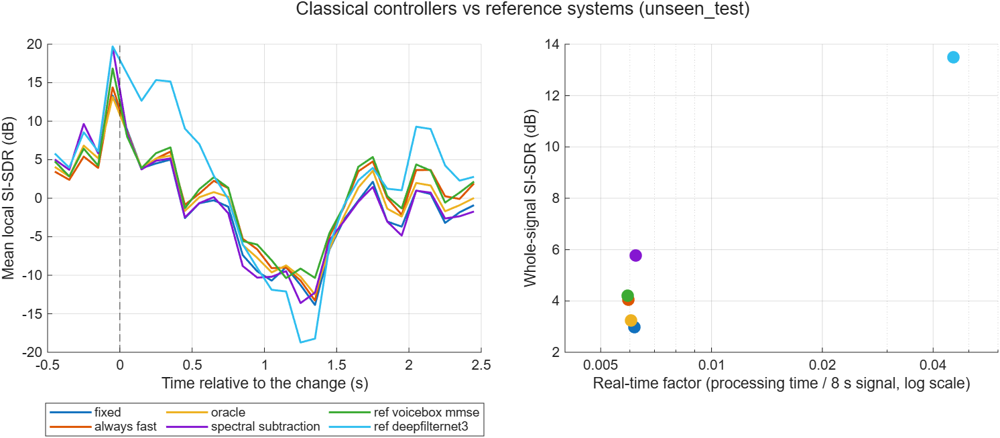
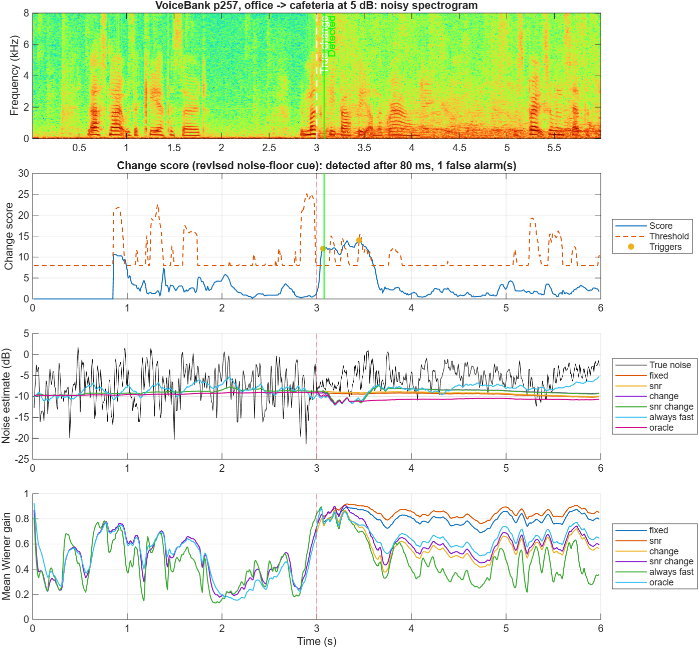

# How Quickly Should a Speech Enhancer Adapt?

## Change-aware Wiener filtering under abrupt background-noise changes

**Liya Xu | SID 530519058 | ELEC5305 Project**

[Source code and full results](https://github.com/Liyaxuxu/elec5305-project-530519058) | [Original proposal](https://github.com/Liyaxuxu/elec5305-project-530519058/blob/main/Proposal/Proposal.pdf) | [Updated proposal](https://github.com/Liyaxuxu/elec5305-project-530519058/blob/main/Proposal/proposal_2.pdf)

**Final report:** [PDF](https://github.com/Liyaxuxu/elec5305-project-530519058/blob/main/report/main.pdf) | **Video demo:** [YouTube](https://youtu.be/natY-4UzcTU) (backup: [Google Drive](https://drive.google.com/file/d/1G7SuL2PIYqyZcJeBJBOGOTtxOiQHFxEb/view))

## Research question

When a causal speech enhancer encounters an abrupt acoustic change, how quickly should it adapt, and does a simple change detector improve the result compared with fixed or SNR-based control?

I use one STFT/Wiener enhancement pipeline for everything. The systems only differ in how fast they update the noise estimate and how much they smooth the gain. Fixed, SNR-only, change-aware, always-fast and oracle controllers are all run on the same mixtures.

## Experiment

Each case contains eight seconds of VoiceBank speech mixed with controlled DEMAND noise. The test conditions include:

- a 10 dB noise-level increase;
- office-to-traffic or office-to-cafeteria changes;
- noise onset and offset;
- the same type change during a short speech pause;
- stationary and clean controls.

I chose the controller settings on p232 development speech, then froze them for p257 validation and a final office-to-cafeteria test with unused utterances and noise excerpts. The final test has a new transition pair, but not a new speaker.

## Main result

| System | Validation SI-SDR (dB) | Cafeteria test SI-SDR (dB) |
|---|---:|---:|
| Noisy input | 1.17 | 1.10 |
| Fixed Wiener | 3.22 | 2.97 |
| SNR-only Wiener | 3.32 | 2.87 |
| Revised change-aware Wiener | 3.66 | 3.31 |
| Original change-aware Wiener | 4.38 | 3.57 |
| Always-fast Wiener | 5.33 | 4.04 |
| VOICEBOX MMSE Wiener | 6.02 | 4.20 |
| Spectral subtraction | 7.20 | 5.76 |
| DeepFilterNet3 | **16.05** | **13.50** |

Among my Wiener controllers, always-fast gives the highest whole-signal SI-SDR. It improves on fixed Wiener by 2.11 dB on validation and 1.07 dB on the cafeteria test. The change-aware controllers also improve SI-SDR, but neither beats always-fast. So most of the benefit seems to come from adapting faster, not from knowing exactly when the change happened.

None of the classical systems improves STOI. DeepFilterNet3 is the only system that improves both SI-SDR and STOI, but it is a pretrained neural network, not the kind of interpretable controller this project is about.

## What the average hides

Whole-signal scores miss two clear failures right at the change:

- When noise starts, the classical noise trackers are too slow to remove it in the first 0.75 seconds.
- When noise stops, the old noise estimate stays high and the systems keep suppressing speech that is now almost clean.

That is why I also report transition SI-SDR, settling time, speech distortion, residual noise and recovery curves. All comparisons are paired by scene, and the confidence intervals come from resampling the six speech sequences.

## Dynamic Speech Enhancement Auditor

The Auditor takes clean speech, two noise recordings, a change time and the SNR before and after. It builds the mixture, runs all the controllers and reference systems, and saves the audio, spectrograms, detector output, noise estimates, gains and metrics.

The example below is an office-to-cafeteria change that was detected after 80 ms, with one false alarm. I picked it with a fixed rule (first excerpt where the change is detected), so it shows how the tool works, not how well the detector does on average.

## Limitations

- The VoiceBank test set only has two speakers, so the final test does not use an unseen speaker.
- Each split contains six speech sequences.
- The Auditor example was picked to show a detected change; the overall detection results are in the detector audit.

## Reproducibility

The repository has the code, automated tests, manifests, per-case results and figures. The VoiceBank and DEMAND audio is not included because it is third-party data. Dataset links, checksums and the complete MATLAB/Python workflow are in the [main README](https://github.com/Liyaxuxu/elec5305-project-530519058#readme).

The earlier [Week 10 checkpoint](feedback-two.html) and [detector audit](https://github.com/Liyaxuxu/elec5305-project-530519058/tree/main/results/detector_revision) are kept as records of the earlier stages of the project.
