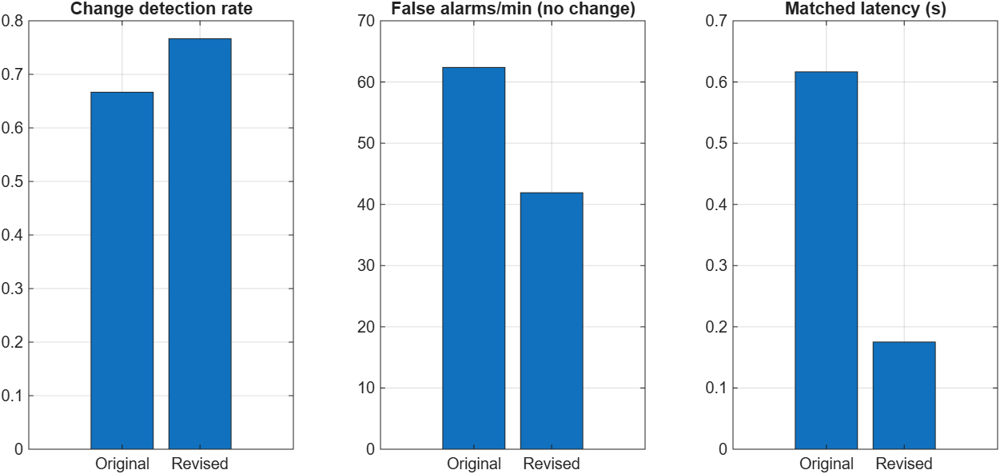
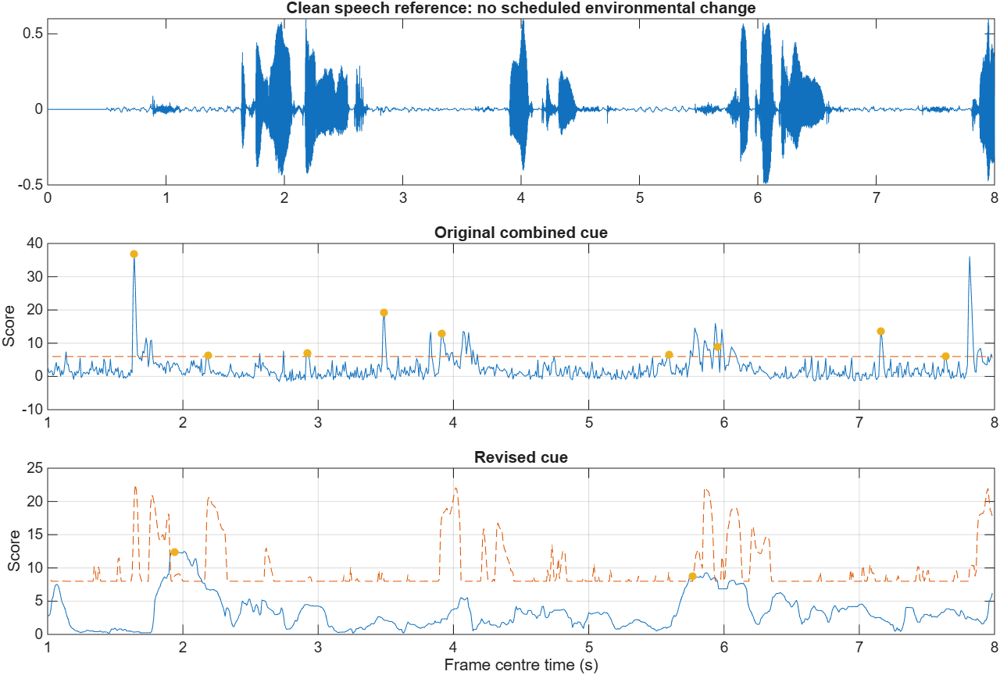

# Detector Audit (October)

The original change detector gave a lot of false alarms (about 62 per minute on scenes where nothing changed). In this experiment I tried a second detector that looks at the noise floor instead of every spectral change, to see if it could cut the false alarms without missing real changes. The original detector is kept as the baseline.

This experiment was done before the controller ablation. It used digital silence for the onset and offset cases; the later ablation uses a -30 dB noise floor instead (see the [main README](../../README.md)).

## Result

Validation set (p257, unused utterances), 48 cases each:

| | Original detector | Revised detector |
|---|---:|---:|
| Changes found within 1.5 s | 20/30 (66.7%) | 23/30 (76.7%) |
| False alarms/min on no-change controls | 62.38 | 41.90 |
| Mean delay, found changes only (s) | 0.617 | 0.175 |
| Mean delay, misses counted as 1.5 s | 0.911 | 0.484 |
| Whole-signal SI-SDR (dB) | 4.507 | 3.612 |
| STOI | 0.83446 | 0.83108 |

So the revised detector is better *as a detector* (fewer false alarms, much shorter delay), but the enhancer using it got slightly worse. This was the first sign that detecting changes more accurately is not the same as enhancing better. The controller ablation later explained why: the original detector's false alarms keep the enhancer in its fast state more often, and faster adaptation is what actually helps.

The average also hides one real failure. False alarms dropped from 65.71 to 27.14 per minute on stationary office noise and from 55.71 to 0 on stationary traffic, but on **clean speech with no noise they went up from 65.71 to 98.57 per minute**. Without a steady noise floor, the low-percentile tracker follows the gaps between syllables.



## How the revised detector works

The original detector takes the maximum of three normalised spectral/modulation scores, so a big change in any one of them triggers it.

The revised one splits the spectrum into 8 bands and tracks a low percentile (20th) of each band's energy, comparing the last 0.20 s with the 0.65 s before that. Short speech peaks barely affect a low percentile, so this behaves like a rough noise-floor estimate. The score is the median absolute band change in dB.

It also raises the threshold when the current energy is more than 6 dB above the floor, which usually means someone is talking. This is only a rough speech hint, not a real voice activity detector.

Settings chosen on development data: floor cue, 8 dB threshold, 4 frames in a row (32 ms), speech weight 0.75, 350 ms hold after each trigger. Without the speech-dependent threshold the same detector gives 46.19 false alarms/min instead of 41.90, with the same 23/30 detections, so most of the improvement comes from the floor cue and the 4-frame rule.

## Setup

- Development: 6 sequences from p232 (sorted file positions 30–77), noise excerpts starting at 70–110 s.
- Validation: 6 sequences from p257 (positions 90–137), noise excerpts starting at 200–240 s. p257 had been used in the pilot, so this is new material from a known speaker, not an unseen speaker.
- Each sequence gives 5 changes (level, type, onset, offset, type during a pause) and 3 no-change controls (office only, traffic only, clean speech), so 48 cases per split.
- The change is placed at a random active-speech point between 2.5 and 4.5 s. The clean reference is only used to build and score the mixtures, never by the detectors.
- Each case starts with 0.5 s of noise only. All systems here only use past frames during that start, unlike the pilot, which used the first 250 ms at once.
- STFT: 32 ms frames, 8 ms hop. A detection time is the time when its frame is fully available (frame centre + 16 ms).
- Scoring: detectors are scored from 1 to 8 s. One alarm within 1.5 s after a change counts as a hit; every other alarm counts as false, including repeated ones. Natural changes in the DEMAND recordings can also trigger alarms, so "false" means "not at the scheduled change".

## Choosing the settings

I tried 48 combinations (two score types, thresholds 4/6/8/10, 2/4/8 frames, speech weight 0 or 0.75). A candidate had to keep its hit rate within 5 percentage points of the original detector on development data, and among those I picked the lowest

```text
false alarms/min + 3 * delay (misses = 1.5 s) + 20 * miss rate
```

The full grid is in [`development_search.csv`](development_search.csv). The chosen setting was saved to [`frozen_config.json`](frozen_config.json) before validation, and nothing was changed afterwards.

## Where the false alarms happen

Every false alarm is saved with its time and whether the clean speech was active at that moment. On validation, 67.2% of the original detector's false alarms and 44.2% of the revised detector's fall within 100 ms of the start of a speech segment. That points to speech onsets being mistaken for scene changes, although I can't prove the cause without phoneme labels.



## Uncertainty and limitations

The bootstrap resamples the 6 speech sequences (with all their conditions), not the 48 cases separately, because the cases from one sequence are not independent. With 5000 resamples:

- no-change false alarms/min: −20.48 [−28.57, −11.90] (clearly lower)
- detection rate: +0.10 [−0.23, +0.47] (not a clear improvement)
- STOI: −0.00338 [−0.00522, −0.00183] (slightly worse)

See [`paired_uncertainty.csv`](paired_uncertainty.csv). This is only six sequences from one speaker and two noise recordings. A detector that fires very often can also "hit" a change by chance inside the 1.5 s window, which is why the no-change controls matter.

When an output reproduces the clean signal exactly, SI-SDR is infinite and is stored as `NaN`, so compare paired cases rather than raw means. `evaluation_runtime_s` is not an end-to-end runtime.

## Reproduce

From the repository root in MATLAB (Signal Processing and Audio Toolboxes):

```matlab
addpath('src');
run_detector_revision('develop');     % selection on p232 only
run_detector_revision('validate');    % uses frozen_config.json
summarise_detector_revision;
addpath('tests');
test_detector_revision;
```

`run_detector_revision('audit_development')` reruns the development audit without repeating the selection. The tests check that future samples never change past decisions, one-to-one event matching and the speech/noise gain decomposition.
